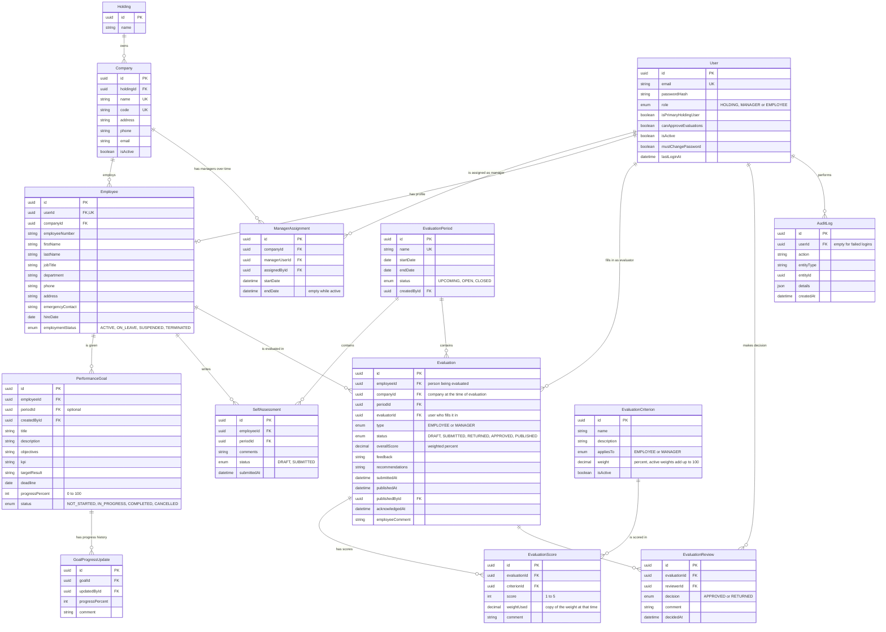

# Phase 4 — Database Design (Draft 1)

**Status:** Draft for review. No tables have been created yet.
**Based on:** SRS sections 1.2, 1.3, 1.4, 1.10, and the decisions in Section 7 of this document.

---

## 1. The ERD (Entity Relationship Diagram)

How to read the lines:
- `||--o{` means **one to many** (for example, one Company has many Employees).
- `||--o|` means **one to zero-or-one** (for example, one User has at most one Employee profile).
- **PK** = primary key (unique ID of the row). **FK** = foreign key (points to another table). **UK** = unique (cannot repeat).



*Every table also has `createdAt` and `updatedAt` (when the row was created and last changed). They are left out of the diagram to keep it readable.*

---

## 2. What each table is for

| Table | Plain explanation | SRS link |
|---|---|---|
| **Holding** | The one parent organization. | 1.1.3, 1.10 |
| **Company** | Each company under the Holding (A, B, C...). | FR-02 |
| **User** | A **login account**: email, scrambled password, and role. Everyone who logs in has one. | FR-01 |
| **Employee** | A person's **work profile**: name, job title, company, status. Managers have one too. Holding users do not need one. | FR-04 |
| **ManagerAssignment** | Records **which Manager runs which company, and since when.** Keeps history when a Manager is replaced. | FR-02, FR-03 |
| **PerformanceGoal** | A goal given to an employee: title, KPI, target, deadline, progress. | FR-05 |
| **GoalProgressUpdate** | Every progress update on a goal, so the **history** is kept. | FR-05 "goal history" |
| **EvaluationPeriod** | A time window for evaluations, such as "2026 Annual". | 1.6.5 |
| **EvaluationCriterion** | What people are scored on (for example "Quality of work", 30%). Separate lists for employees and managers. | FR-07 |
| **SelfAssessment** | An employee's own comments about their performance in a period. | FR-06 |
| **Evaluation** | One person's evaluation for one period: status, overall score, feedback, acknowledgement. | FR-07, FR-08 |
| **EvaluationScore** | The score for **one criterion** inside an evaluation. | FR-07 |
| **EvaluationReview** | Each approve or return decision, with comments. Several rows = full history. | FR-08 |
| **AuditLog** | A record of important actions: who did what, and when. | FR-10 |

---

## 3. Relationships explained

1. **One Holding → many Companies.**
2. **One Company → many Employees.** Each employee belongs to **one company at a time** (`Employee.companyId`).
3. **One User ↔ at most one Employee profile.** Holding users have a login but no employee profile.
4. **Company ↔ Manager** goes through **ManagerAssignment**. The current Manager is the row with **no `endDate`**. Rule: **only one active Manager per company** (enforced by the database).
5. **One Employee → many Goals → many Progress Updates.**
6. **One Employee → one Self-Assessment per period** (an employee cannot submit two for the same period).
7. **One Employee → one Evaluation per period.**
8. **One Evaluation → many Scores** (one per criterion) and **many Reviews** (history of decisions).

---

## 4. Important rules the database will enforce

| Rule | How |
|---|---|
| Two accounts cannot share an email | `User.email` is unique |
| Two companies cannot share a name or code | `Company.name` and `Company.code` are unique |
| Employee numbers do not repeat **inside a company** | unique together: `companyId` + `employeeNumber` |
| One self-assessment per employee per period | unique together: `employeeId` + `periodId` |
| One evaluation per person per period | unique together: `employeeId` + `periodId` |
| Each criterion scored once per evaluation | unique together: `evaluationId` + `criterionId` |
| Only one active Manager per company | enforced by the backend: assigning a new Manager ends the old assignment in the same database transaction |
| No row can point to something that does not exist | foreign keys |
| Nothing important is ever deleted | records are **deactivated** (`isActive = false`) instead of deleted |

---

## 5. The evaluation steps (the same for employees and managers)

```
DRAFT ──submit──▶ SUBMITTED ──approve──▶ APPROVED ──publish──▶ PUBLISHED ──▶ (acknowledged by the person)
                      │
                      └──return──▶ RETURNED ──fix and submit again──▶ SUBMITTED
```

| | Employee evaluation | Manager evaluation |
|---|---|---|
| Filled in by | Their company's Manager | The primary Holding user, or a Holding user they allow |
| Approved by | The primary Holding user, or a Holding user they allow | The primary Holding user, or a Holding user they allow |
| Seen by the person | Only after PUBLISHED | Only after PUBLISHED |

---

## 6. Design choices explained

**Why `User` and `Employee` are separate tables:** a User is "how you log in"; an Employee is "your work details". Holding users need a login but no employee details. Keeping them apart also keeps the password away from everyday employee data.

**Why `role` is a field instead of separate Role and UserRole tables:** the SRS lists Role and UserRole tables, which are used when one person can have **several** roles. In our system every person has **exactly one** role (Holding, Manager or Employee), so a single field does the same job more simply. If several roles per person are ever needed, a table can be added later.

**Why the Holding users' powers are two yes/no fields:**
- `isPrimaryHoldingUser` — the person at the top. Can do everything, including switching approval permission on or off for other Holding users.
- `canApproveEvaluations` — whether this Holding user may approve evaluations. Always true for the primary Holding user.

**Why publication is fields on `Evaluation` (`publishedAt`, `publishedById`) instead of a separate table:** an evaluation is published only once, so two fields are enough. This replaces the SRS's "Evaluation Publication" entity with the same information.

**Why `Evaluation.companyId` exists even though Employee already has a company:** if an employee moves to another company, their **old** evaluations must stay with the **old** company. This column remembers the company at the time of the evaluation.

**Why `EvaluationScore.weightUsed` copies the weight:** if the Holding changes a criterion's weight next year, old evaluations must keep the weight that was used at the time. Otherwise old scores would silently change.

**Why IDs are UUIDs** (long random IDs like `3f2a9c1e-...`) instead of 1, 2, 3: a simple number lets someone guess other IDs (if they are employee 15, they may try 16). Our backend checks permissions on every request anyway, but random IDs add a second layer of protection.

---

## 7. Decisions and assumptions (to confirm with the supervisor)

| # | Decision | Status |
|---|---|---|
| 1 | One Holding organization. | Agreed |
| 2 | Several people can log in as Holding users. | Agreed |
| 3 | One **primary Holding user** (the head of the organization) has all powers. | Agreed |
| 4 | Other Holding users can view and manage, but approve evaluations **only if the primary Holding user allows it**. Every change is recorded in the audit log. | Agreed |
| 5 | One active Manager per company. The Manager also has an employee profile. | Agreed |
| 6 | **Managers are evaluated** by the primary Holding user (or an allowed Holding user). Not mentioned in the SRS. | Agreed; to confirm with supervisor |
| 7 | **Every evaluation needs an approval step**, including Manager evaluations. | Agreed; to confirm with supervisor |
| 8 | Evaluation periods are created by Holding users and apply to all companies. | Assumed |
| 9 | Criteria and weights are set by Holding users, with separate lists for employees and managers. Active weights add up to 100%. | Assumed |
| 10 | Each criterion is scored **1 to 5**; the overall score is a weighted percentage. | Assumed |
| 11 | Self-assessment is **optional**; the Manager can see whether it was submitted. | Assumed |
| 12 | Employees can update goal progress (percent and a comment) only. | Assumed |
| 13 | After publication, the person can **acknowledge** and add **one comment**; this does not reopen the evaluation. | Assumed |
| 14 | Employees can move between companies; old evaluations stay with the old company. | Assumed |
| 15 | Nothing important is deleted; records are deactivated instead. | Assumed |
| 16 | Role is stored as one field on User instead of separate Role and UserRole tables. | Design choice |
| 17 | Publication is stored as fields on Evaluation instead of a separate table. | Design choice |
| 18 | Nobody approves an evaluation they submitted, except the primary Holding user. | Assumed |
| 19 | An evaluation can be returned only while its period is open; approving and publishing are allowed after it closes. | Assumed |
| 20 | Reports count only final results (approved or published) in averages and completion rates. | Assumed |
| 21 | Manager performance = share of their team's evaluations submitted, share submitted on time, times returned, and the team's average score. | Assumed |
