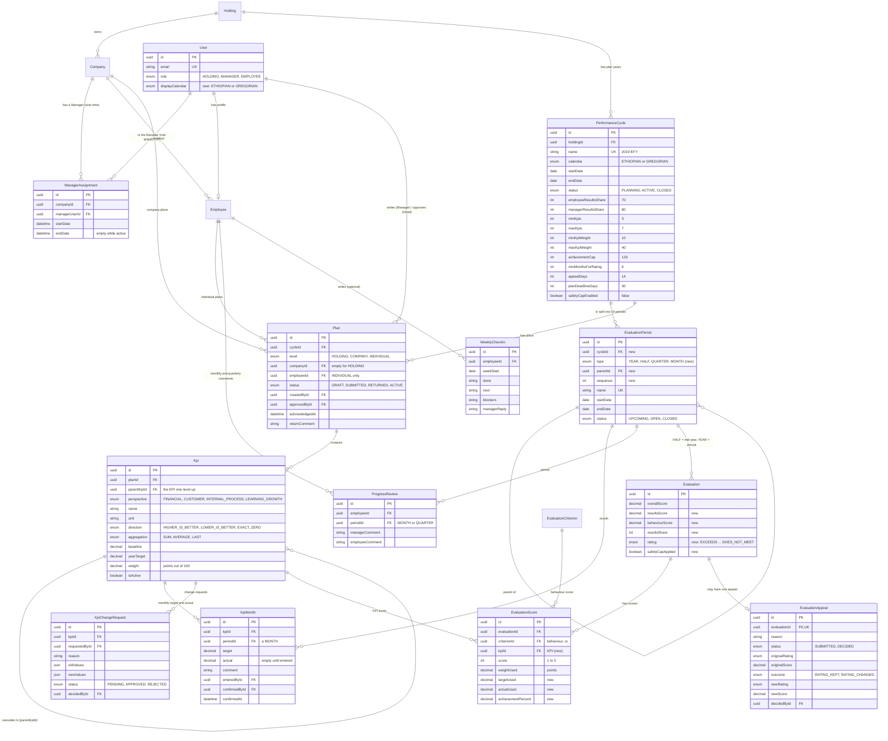

# Version 2 — Plan-Based Evaluation: Database Design (Draft 2)

**Status:** Draft 2 — the 5 open points are decided (section 9). No tables have been changed yet.
**Based on:** the approved design decisions in the doc *"Taf EMS — Plan-Based Evaluation: Design Decisions"* (UN performance cycle, Balanced Scorecard cascade, KPIs, Ethiopian calendar by default) and *"Questions & Answers"*.

---

## 0. The idea in one picture

```
Head makes the PLAN YEAR  ──►  19 periods are created automatically
                                (1 year, 2 halves, 4 quarters, 12 months)

Holding plan (KPIs)            ◄── Head
   └── Company plan (KPIs)     ◄── Manager writes, Head approves
          └── Employee plan    ◄── Manager writes with the employee, employee acknowledges

Every KPI has a target for each MONTH  ──►  each month the real number (actual) is entered and confirmed
                                       ──►  quarter / half / year results are calculated from the months

Mid-year review (HALF period)  and  Annual evaluation (YEAR period)
   = KPI scores (calculated)  +  behaviour scores (the evaluator)  →  rating  →  approve → publish → acknowledge → (appeal)
```

### 0.1 Where is the Manager?

The Manager is **not** replaced — the order is still **Holding → Manager → Employee**. Since version 1, a Manager is stored in three linked places:

| Table | What it says about Selam |
| --- | --- |
| `User` (role = MANAGER) | Her login: manager.alpha@demo.local |
| `Employee` | Her profile: Selam Tesfaye, General Manager, Alpha Energy |
| `ManagerAssignment` | She is the Manager **of Alpha Energy**, from this date (to that date) |

The hierarchy in version 2:

| Level | Who | Their plan | Plan written by | Evaluated by |
| --- | --- | --- | --- | --- |
| Holding | Head (`User`, role HOLDING) | Holding plan | Head | — |
| Manager | Manager (`User` role MANAGER + `ManagerAssignment`) | **Company plan = the Manager's plan** | Manager, **approved by the Head** | Head |
| Employee | Employee (`User` role EMPLOYEE + `Employee`) | Individual plan | Manager, with the employee | Manager |

**Why is the Manager's plan stored on the company and not on the person?** Managers can change during the year. If Selam leaves in Tir and a new Manager arrives, the targets and the months already recorded stay with Alpha Energy, and the new Manager simply continues them. `ManagerAssignment` tells the system who was the Manager in which months. A Manager is evaluated on the company plan if they managed the company for at least 6 months of the year (the same 6-month rule as everyone).

See the picture `docs/Taf-EMS-hierarchy-v2.png`.

---

## 1. What changes — summary

**8 new tables**

| Table | What it holds (simple words) |
| --- | --- |
| `PerformanceCycle` | One **plan year** (e.g. "2019 EFY") and the rules for that year (70/30 split, 120% cap, 14-day appeal, …). |
| `Plan` | One plan: the Holding's plan, a company's plan, or one employee's plan. |
| `Kpi` | One measured target inside a plan (e.g. "Deliveries completed: 1,200 per year"). |
| `KpiMonth` | For one KPI and one month: the **target** and the **actual**, side by side. |
| `KpiChangeRequest` | A request to change a KPI target during the year, with the reason and the decision. |
| `ProgressReview` | The short Manager / employee comments at the monthly and quarterly check. No score. |
| `WeeklyCheckIn` | **Optional.** The employee's 3 lines (done, next, blockers) and the Manager's reply. No score. |
| `EvaluationAppeal` | An employee's appeal against a low rating, and the decision. |

**6 changed tables** (only new columns; nothing is deleted)

| Table | What is added |
| --- | --- |
| `Holding` | `cycleCalendar` (Ethiopian or Gregorian plan year), `weeklyCheckInsEnabled` (on/off switch, **on** by default). |
| `User` | `displayCalendar` — how this person sees dates (EC or GC). |
| `EvaluationPeriod` | `cycleId`, `type` (YEAR / HALF / QUARTER / MONTH), `parentId`, `sequence` → the **period tree**. |
| `EvaluationCriterion` | Now used for **behaviours**: `levelDescriptions` (what 1–5 look like), `isSafety`. |
| `Evaluation` | `resultsScore`, `behaviourScore`, `resultsShare`, `rating` (the UN label), `safetyCapApplied`. |
| `EvaluationScore` | Can now hold a **KPI score** (`kpiId`, target, actual, achievement %) as well as a behaviour score. |

**Kept and reused without changes:** `SelfAssessment` — the employee (or Manager) writes one for the mid-year review (HALF period) and one for the annual evaluation (YEAR period). `EvaluationReview` — the approve / return history, exactly as today.

**Kept as they are for now:** `PerformanceGoal` and `GoalProgressUpdate` (the version 1 goals). KPIs replace them, but the tables are **not deleted** — deleting is a destructive change, so we will only do it later, if the supervisor agrees.

---

## 2. The ERD (new and changed tables)

How to read the lines (same as in `03-database-design.md`):
`||--o{` = one to many · `||--o|` = one to zero-or-one · **PK** primary key · **FK** foreign key · **UK** unique.



A picture of this diagram is in `docs/Taf-EMS-ERD-v2.png`.

---

## 3. Each new table, in simple words

### 3.1 `PerformanceCycle` — the plan year

- The Head creates it, for example **"2019 EFY"** = Hamle 1, 2018 to Sene 30, 2019 (8 July 2026 – 7 July 2027).
  *(Name rule: an Ethiopian fiscal year is named by the year it ends in. To confirm with the supervisor.)*
- `calendar` is copied from the Holding setting when the year is created. Changing the Holding setting later does not change years that already exist.
- **The rules of the year are stored in the year itself** (`employeeResultsShare`, `achievementCap`, `appealDays`, …). This is important: if next year the company decides 60/40 instead of 70/30, this year's evaluations still use 70/30. The Head can change them only while the year is in `PLANNING`.
- `status`: `PLANNING` (plans are being written) → `ACTIVE` (the year is running) → `CLOSED` (all evaluations are finished; nothing can change).

### 3.2 The period tree (changed `EvaluationPeriod`)

When the Head creates a plan year, the system creates **19 periods** in one go:

| type | how many | sequence | parent | Example (Ethiopian year) |
| --- | --- | --- | --- | --- |
| YEAR | 1 | 1 | — | 2019 EFY |
| HALF | 2 | 1–2 | the year | H1 = Hamle → Tahsas |
| QUARTER | 4 | 1–4 | its half | Q1 = Hamle, Nehase, Meskerem |
| MONTH | 12 | 1–12 | its quarter | M2 = Nehase **+ Pagume** |

- **Pagume** (5 or 6 days) is joined to Nehase, so there are always 12 months.
- For a Gregorian year: January 1 – December 31, H1 = Jan–Jun, Q1 = Jan–Mar, months are the normal 12 months.
- Dates are always **stored in Gregorian** (the computer standard). They are converted to Ethiopian only when shown.
- `status` of a **month**: `UPCOMING` → `OPEN` (actuals can be entered) → `CLOSED` (actuals are frozen).
- Old version-1 periods keep `cycleId` empty, so nothing old breaks.
- Rule: `(cycleId, type, sequence)` is unique — a year cannot have two "Q1".

### 3.3 `Plan`

| level | companyId | employeeId | Written by | Approved by | Then |
| --- | --- | --- | --- | --- | --- |
| HOLDING | empty | empty | Head | — (Head's own plan) | ACTIVE |
| COMPANY | the company | empty | that company's Manager | Head (or a Holding user who can approve) | ACTIVE |
| INDIVIDUAL | the employee's company | the employee | the employee's Manager | — | ACTIVE → employee **acknowledges** |

- Status flow for a company plan: `DRAFT → SUBMITTED → ACTIVE`, or `SUBMITTED → RETURNED → DRAFT …` with a `returnComment` (the same idea as evaluations today).
- One plan per level per year: one Holding plan, one plan per company, one plan per employee. *(PostgreSQL treats "empty" values as all different, so the migration adds `NULLS NOT DISTINCT` to this unique rule; the service also checks it.)*
- **Manager's own plan = the company plan.** A Manager has no separate individual plan. Their results score comes from the company plan.

### 3.4 `Kpi`

| Column | Meaning | Example |
| --- | --- | --- |
| `parentKpiId` | The KPI one level up that this one helps to reach. **This keeps the hierarchy.** | Dawit's "Deliveries" → Alpha's "Deliveries" → Holding's "Group deliveries" |
| `perspective` | Balanced Scorecard group | INTERNAL_PROCESS |
| `unit` | What is counted | "deliveries", "%", "litres", "ETB" |
| `direction` | Which result is good | HIGHER_IS_BETTER |
| `aggregation` | How months add up to a quarter and a year | SUM |
| `baseline` | Last year's value (optional, for comparison) | 1,050 |
| `yearTarget` | The target for the whole year | 1,200 |
| `weight` | Points out of 100 (empty on the Holding plan) | 30 |

**`aggregation` — why it is needed:**

| aggregation | Use it for | Year result = | Example |
| --- | --- | --- | --- |
| SUM | things you count | months added up | deliveries: 100 + 104 + … |
| AVERAGE | rates and percentages | average of the months | on-time %: (92 + 95 + 90) ÷ 3 |
| LAST | a level at a moment | the last month's value | stock level at the end of the year |

Safety incidents (`ZERO` direction) use SUM: the year result is the total number of incidents.

**Rules checked by the system (from the cycle settings):**
- An INDIVIDUAL KPI **must** have a `parentKpiId` pointing to a KPI of **the same company's** plan, in **the same year**. A COMPANY KPI must point to a HOLDING KPI. → hierarchy + company wall.
- Number of active KPIs in a plan: between `minKpis` and `maxKpis` (3–7).
- Each weight between `minKpiWeight` and `maxKpiWeight` (10–40 points).
- Weights of a plan add up to the results share: **70** for an employee plan, **80** for a company plan.
- A company plan has at least one KPI in each of the 4 perspectives.
- The system **warns** (does not block) when the employees' targets do not add up to the company target.

### 3.5 `KpiMonth` — target and actual, side by side

One row per KPI per month (so a KPI has 12 rows).

- `target` is filled when the plan is made: the year target split equally, or edited by hand (e.g. more deliveries in the dry season). Rule: with SUM, the 12 months must add up to `yearTarget`.
- `actual` is empty until someone enters it:
  - **Individual KPI:** the employee enters, the Manager confirms.
  - **Company KPI:** the Manager enters, the **Head confirms** (because the Manager's own score depends on it).
- **Only confirmed actuals count** in scores and reports.
- When a month is `CLOSED`, its row cannot change any more.
- Traffic light (🟢🟡🔴) is **calculated**, not stored: achievement so far compared with target so far.

### 3.6 `KpiChangeRequest` — changing a target during the year

- Allowed at the mid-point review or for a big event. A `reason` is required.
- `oldValues` / `newValues` keep the year target, the weight and the monthly split, before and after.
- Who decides: employee KPI → Manager requests, Head decides. Company KPI → only the Head (decides directly; the request is still saved for the history).
- When approved, only the months that are **not closed** get the new targets. Every change is also written to the audit log.

### 3.7 `ProgressReview` — monthly and quarterly comments

- One row per employee per MONTH or QUARTER: the Manager's comment and the employee's comment.
- **No score is stored.** The progress score shown on the screen is calculated from `KpiMonth`.

### 3.8 `WeeklyCheckIn` — optional

> **Weekly check-in note (decided: build it).** The employee writes 3 short lines (done, next, blockers) and the Manager can reply. There's no score; it's a memory aid. At the end of the year, the Manager can read these notes so nothing is forgotten. 

- Built in Module 14 and **on** by default. The Head can switch it off for the whole Holding (`Holding.weeklyCheckInsEnabled`) — for example during a very busy month, or if the company later decides it is too much work. Switching it off hides the pages; old notes are kept.
- One check-in per employee per week (`weekStart` = the Monday). The employee can edit it until the Manager replies.
- Only the employee, their Manager and Holding users can read it (company wall).

### 3.9 `EvaluationAppeal`

- Only for ratings **Partially meets** or **Does not meet**, within `appealDays` (14) after the employee acknowledges.
- One appeal per evaluation (`evaluationId` is unique).
- `originalRating` / `originalScore` are copied, so the history is never lost.
- Decided by a Holding user who can approve and who **did not write or approve** that evaluation. Outcome: `RATING_KEPT` or `RATING_CHANGED` (with `newRating`, `newScore`). Final, and written to the audit log.

---

## 4. Each changed table, in simple words

### 4.1 `Holding` and `User`
- `Holding.cycleCalendar` (default ETHIOPIAN): which calendar **new** plan years follow.
- `Holding.weeklyCheckInsEnabled` (default true).
- `User.displayCalendar` (default ETHIOPIAN): each person chooses how dates are **shown**. Changing it never changes data.

### 4.2 `EvaluationCriterion` → behaviours
The existing criteria table becomes the **behaviour** list (the screen will call it "Behaviours").
- `appliesTo = EMPLOYEE` list: Safety, Integrity, Teamwork, Customer focus, Accountability, Initiative.
- `appliesTo = MANAGER` list: the same six **plus** Leadership, Planning & decision-making.
- `weight` = percent **of the behaviour part** (each list adds up to 100). In an evaluation it is turned into points: e.g. 6 behaviours × 16.67% of 30 points = 5 points each.
- `levelDescriptions` = what a 1, 2, 3, 4, 5 look like (stored as JSON, checked by zod).
- `isSafety = true` on "Safety" — used by the optional safety rule.

### 4.3 `Evaluation`
- An evaluation on a **HALF** period (H1) is the **mid-year review**; on a **YEAR** period it is the **annual evaluation**. Same table, same approve/return/publish flow as today.
- New: `resultsScore` (points from KPIs), `behaviourScore` (points from behaviours), `resultsShare` (70 or 80, copied), `rating`, `safetyCapApplied`.
- `overallScore = resultsScore + behaviourScore`, out of 100.
- No evaluation is created for someone with fewer than `minMonthsForRating` (6) months in the year.

### 4.4 `EvaluationScore`
- A row is **either** a behaviour score (`criterionId`) **or** a KPI score (`kpiId`) — never both, never neither (checked in the service and by a database `CHECK` rule).
- For a KPI row, the system fills `targetUsed`, `actualUsed`, `achievementPercent` (after the 120% cap) and `score` (1–5) **automatically**. The evaluator can only add a comment.
- `weightUsed` is now always **points** out of 100.

---

## 5. How a score is calculated (where the numbers come from)

```
For each KPI of the person's plan (company plan for a Manager):
    target  = aggregation of KpiMonth.target   over the months of the period (H1 or year)
    actual  = aggregation of KpiMonth.actual   over the same months (confirmed only)
    achievement % = formula by direction, then capped at achievementCap (120)
    score 1-5    = 110%+ → 5 · 100–109 → 4 · 85–99 → 3 · 70–84 → 2 · below 70 → 1
    points       = score ÷ 5 × weight
resultsScore   = sum of KPI points                       (max 70 or 80)
behaviourScore = sum of (score ÷ 5 × weight% × behaviour part)   (max 30 or 20)
overallScore   = resultsScore + behaviourScore            (max 100)
rating         = 90+ EXCEEDS · 75–89 SUCCESSFULLY_MEETS · 55–74 PARTIALLY_MEETS · below 55 DOES_NOT_MEET
safety rule (if on): Safety behaviour = 1 → rating at most PARTIALLY_MEETS
```

All formulas live in **one file** (`evaluation.scoring.js`, extended) with unit tests for every direction, aggregation and band.

---

## 6. Security and the company wall (same rules as version 1)

- Every plan, KPI, month row, review, check-in and appeal is reached **through** an employee or a company. Services always load the company from the database and compare it with the Manager's company — never trust an id from the URL.
- A Manager can never link a KPI to another company's KPI, read another company's plan, or confirm another company's actuals.
- An employee sees only their own plan, actuals, check-ins, evaluations and appeal.
- Every create / change / approve / confirm / appeal decision is written to the audit log.
- Closed months and published evaluations are frozen (conditional updates, like today's review decisions).

---

## 7. Migration plan (how we change the database safely)

- **Additive only:** new tables and new columns with default values. No column or table is deleted or renamed → existing data and the 479 API tests keep working.
- One migration per module (below), created on your Mac with `npm run db:migrate`, and reviewed before commit.
- The development database can be re-seeded with new demo data (demo plan year, plans, KPIs, months) — **no real employee data**.
- Deleting the old Goals tables is **not** in this plan. If the supervisor agrees later, it will be a separate step, explained first.

---

## 8. Build plan — module by module

Each module = database migration + backend (routes → controller → service → repository) + unit tests + Postman tests + frontend page(s), then you test, commit and merge, like before.

| Module | What | Tables |
| --- | --- | --- |
| 11 | **Calendar & plan year**: Ethiopian ↔ Gregorian converter (own code, unit-tested), Holding / user calendar settings, create a plan year → 19 periods, open/close months | PerformanceCycle, EvaluationPeriod, Holding, User |
| 12 | **Plans & KPIs**: Holding, company and individual plans, cascade links, rules (3–7, 10–40, sums), monthly split, submit / approve / return, acknowledge | Plan, Kpi, KpiMonth (targets) |
| 13 | **Monthly actuals & progress**: enter / confirm actuals, traffic lights, monthly and quarterly comments, close a month | KpiMonth (actuals), ProgressReview |
| 14 | **Weekly check-ins (optional)**: on/off switch, write / reply / read | WeeklyCheckIn |
| 15 | **Behaviours**: level descriptions, safety flag, new seed lists | EvaluationCriterion |
| 16 | **Evaluations v2**: mid-year and annual evaluations with automatic KPI scores, rating, safety rule, 6-month rule | Evaluation, EvaluationScore |
| 17 | **Target changes** | KpiChangeRequest |
| 18 | **Appeals** | EvaluationAppeal |
| 19 | **Reports v2**: plan vs actual per month / quarter, on-track / at-risk lists, rating distribution | — |

---

## 9. Decisions (confirmed 17 Nov 2026)

| # | Point | Decision |
| --- | --- | --- |
| 1 | Year name | **"2019 EFY"** = Hamle 1, 2018 – Sene 30, 2019 (the current year), named by the year it ends in. |
| 2 | Company actuals | The **Head confirms** the actual numbers the Manager enters for the company plan, because the Manager's own score depends on them. |
| 3 | Appeals | Decided by **one** Holding user who can approve and who **did not write or approve** that evaluation. (The UN uses a panel of three people chosen from three lists; Taf has too few Holding users for that. The table can be extended to a panel later if needed.) |
| 4 | Weekly check-ins | **Build now (Module 14), switched on by default.** The Head can switch it off. |
| 5 | Old Goals | Once KPIs work (after Module 13), the Goals pages are **hidden from the menu**, and the tables are **kept** (no data is deleted). KPIs replace goals because a KPI is a goal with a number, a monthly target and a link to the company plan; having both would confuse users. |
